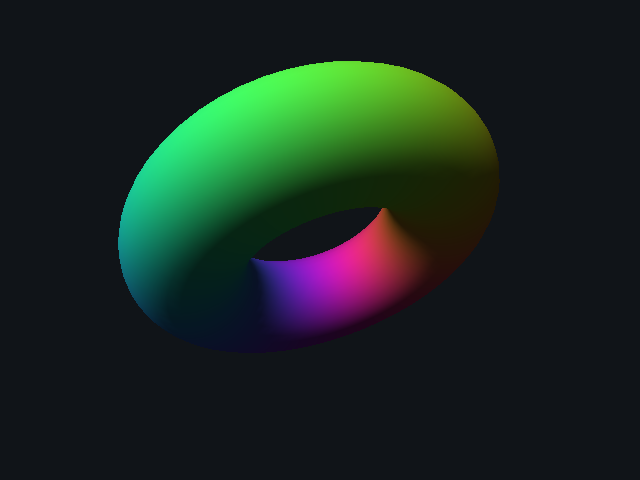
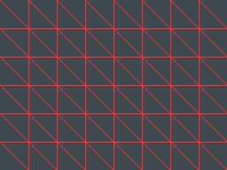

# gpuval: Bit-Accurate FP16 Model & Tiled Rasterizer Verification

A C++17 validation toolkit for two pieces of GPU hardware behavior: a half-precision
floating-point unit and a fixed-point triangle rasterizer. Each one has an integer-only
model, an independent golden reference, and a verification suite, plus a fault-injection
campaign that plants realistic bugs to measure how strong the test plan is.

**Headline results**
- FP16 model is bit-exact against x86 F16C silicon across **all 4,294,967,296** float32 inputs.
- Add and multiply are bit-exact across **all 4.29 B operand pairs** each.
- Tiled rasterizer is bit-identical to a brute-force golden model across **208 M** pixel comparisons, with **zero cracks or overdraw** on shared-edge meshes.
- Coarse tile reject/accept cuts per-pixel edge tests by **97.2%**.
- **6 of 6** planted hardware bugs are caught, each reported with its first failing vector.



## Components

| File | Description |
|---|---|
| `fp16.cpp` | Integer-only IEEE 754 binary16 unit: float conversion, add, multiply and fused multiply-add. Round-to-nearest-even, subnormals, signed zeros, infinities and NaN. All operations share one `round_pack()` rounding stage, mirroring an FPU's align → compute → normalize → round datapath. |
| `reference.cpp` | Two independent references: x86 **F16C instructions** (`VCVTPS2PH` / `VCVTPH2PS`) and the compiler's `_Float16` runtime, fed exact results formed in `double` / `__float128` so the only rounding is the final one. |
| `raster.cpp` | 24.8 fixed-point rasterizer with exact integer edge functions, the **top-left fill rule**, depth test and rounded barycentric interpolation. A brute-force golden model and an **8×8 tiled DUT** with trivial reject/accept and incremental edge stepping. |
| `test_fp16.cpp` | Multithreaded verification: exhaustive over conversions, add and mul; a directed corner-case cross product; constrained-random FMA biased toward catastrophic cancellation. |
| `test_raster.cpp` | **Watertightness** on jittered, pixel-center-snapped, sub-pixel and high-valence fan meshes. **Differential** comparison of color, depth and coverage after every triangle. A **CRC32 frame signature** checked against a stored golden value. |
| `main.cpp` | CLI, scene renderer, and the **fault-injection campaign**. |

## Fault-injection campaign

Each bug is switched on in the device under test only. The campaign records which checks fail and the first failing vector.

| Planted bug | Caught by | First failing vector |
|---|---|---|
| Ties round away from zero | conversion, add, mul, fma | `from_float(0x3EDE9000) = 0x36F5`, expected `0x36F4` |
| Subnormals flushed to zero | conversion, round trip, add, mul, fma | `from_float(0x35DBE63E) = 0x0000`, expected `0x001B` |
| FMA rounds the product before adding | fma | `fma(0x8001, 0x0001, 0x0000) = +0`, expected `-0` |
| Fill rule ignored on shared edges | watertight, differential, signature | pixel (20,18) covered 7 times |
| Tile trivial-accept checks 3 of 4 corners | watertight, differential, signature | pixel (79,1) covered 2 times |
| Interpolation truncates instead of rounding | differential, signature | green channel `0xA8`, expected `0xA9` |

The FMA case is the most interesting. The exact product −2⁻⁴⁸ is nonzero, so the fused result keeps its sign and rounds to −0. Rounding the product first collapses it to −0, and −0 + +0 gives +0. That one-bit sign difference is invisible to most tests and is caught here only because the model is bit-accurate.



## Build and run

Requires x86-64 Linux or WSL2 with GCC and CMake.

```bash
sudo apt install -y build-essential cmake
cmake -B build -DCMAKE_BUILD_TYPE=Release
cmake --build build -j
./build/gpuval --quick      # reduced vector counts, a few seconds
./build/gpuval              # full exhaustive run
```

Run one part at a time with `fp16`, `raster`, `faults` or `render`.

## Results

Full exhaustive run: 78 s on a 12-thread desktop.

```
[PASS] to_float   exhaustive         65,536 vectors      0 fails
[PASS] from_float exhaustive  4,294,967,296 vectors      0 fails   (vs x86 F16C)
[PASS] add        exhaustive  4,294,967,296 vectors      0 fails
[PASS] mul        exhaustive  4,294,967,296 vectors      0 fails
[PASS] fma        random         67,108,864 vectors      0 fails
[PASS] watertight meshes          1,785,620 pixels       0 fails
[PASS] differential vs golden   208,695,230 pixel cmps   0 fails
tiles: 57.8% trivially rejected, 39.1% trivially accepted, 3.1% partial
per-pixel edge tests: 97.2% fewer than brute force
6 of 6 planted bugs caught
```

## Next steps

- Run the same FP16 vectors on a GPU through a Vulkan or Metal compute shader and compare against the model.
- Add perspective-correct interpolation and a fixed-point bilinear texture sampler.
- Extend `round_pack()` to bf16 and FP8 (E4M3 / E5M2).